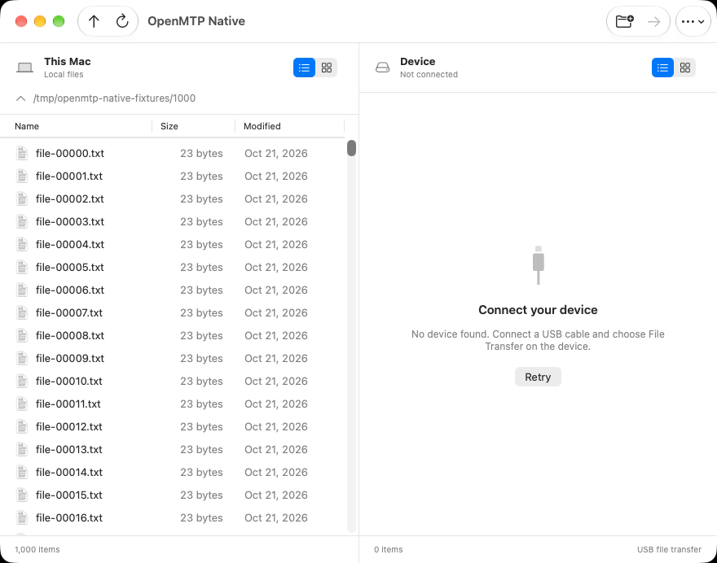
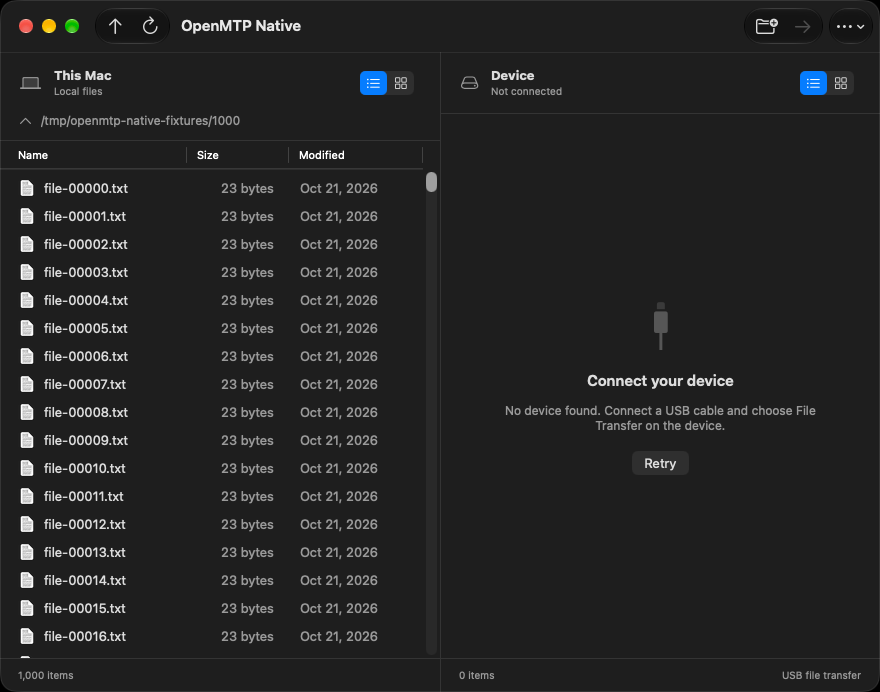

# Native preview acceptance

Done, with gaps: physical-phone, local-host performance, and manual accessibility acceptance remain unverified.

Checked on 2026-10-22: source `78ac2498622ea70516108667c673f76ea16da0d7` passed both complete hosted test batches.
Each batch passed 45 unit tests, four UI tests, and one browser performance test.
The final observations met every hosted performance threshold below.
Desktop automation on the user's Mac remained stopped.

## Verified environments

| Environment | Complete gate | Source |
| --- | --- | --- |
| macOS 26.6.2 arm64, Xcode 26.6 | 50 passed, zero failures | [Run 39687626334](https://github.com/unhingedpanda/openmtp/actions/runs/39687626334) |
| macOS 27.0.1 arm64, Xcode 27.0 | 50 passed, zero failures | [Run 39687702395](https://github.com/unhingedpanda/openmtp/actions/runs/39687702395) |

Both release bundles passed identifier, icon, architecture, library-pair, signature, quarantine, notice, and size checks.
The workflow also verified ordinary launches for the preview and an independent minimal SwiftUI control.
The UI tests used no New Window command or custom Apple event.

## Hosted observations

These measurements describe the hosted Macs, not the user's Mac.
They do not establish a measured speedup over Electron.

| Metric | macOS 26 | macOS 27 | Unchanged target |
| --- | ---: | ---: | ---: |
| Uncompressed arm64 bundle | 5.26 MiB | 5.21 MiB | ≤50 MiB |
| Median warm first window | 0.583 s | 0.405 s | ≤0.75 s |
| Summed RSS after 30 seconds | 118.58 MiB | 127.05 MiB | ≤150 MiB |
| CPU over 30 seconds, one core | 0.57% | 0.43% | ≤1% |
| 10000-entry component response, p95 | 34.76 ms | 36.02 ms | ≤100 ms |

The release workload contained 1000 local fixture files and no connected phone.
The measured window was 880 by 692 points, including its toolbar, on both environments.
Ten warm launches followed one excluded cache-prime launch.
A monotonic timer ran from the NSWorkspace request to the first owned on-screen CoreGraphics window.
Observer process startup was excluded.
RSS and CPU included the owned process and any descendants.

The component test measured 100 selection and Down Arrow actions against 10000 real fixture files.
It used a hidden AppKit window and a debug test build.
It does not measure physical input-to-screen latency.
Launch-report status flags are diagnostic only.
Acceptance uses the observed window and process samples.

An earlier macOS 27 observation at `f668ffd` measured 0.855 seconds and missed the warm-window target.
[Run 39685231727](https://github.com/unhingedpanda/openmtp/actions/runs/39685231727) and its downloaded data remain preserved.
The final batch followed the justified UI and harness corrections.
No threshold changed to obtain a pass.

## Interface and safety verification

The preview retains the two-pane workflow with native toolbar controls, menus, file views, inline rename, and transfer presentation.
The existing Kalam engine remains in place.
Final light/dark captures show all metadata columns and unobscured footers at the minimum content size.
The resize regression passed at 440, 550, and 440 points.

Regression fixtures cover nested upload conflicts, name aliases, empty folders, storage-switch readiness, USB identity, stale queued calls, and promised-export collisions.
The disconnected UI check exercised the real bundled engine.
The focus check preserved the selected local file after focus moved to the disconnected device pane.
[REVIEW.md](REVIEW.md) maps the independent findings, corrections, RED/GREEN evidence, and remaining limits.

## Local preview

App: `/Users/yash/Downloads/Code/products/openmtp-native/native/macos/build/final-bca90b9/Build/Products/Release/OpenMTP Native.app`.

The local bundle is 5.21 MiB and passed every bundle check.
It was built at `bca90b9` with one low-priority build job.
Its product source is identical to tested source `78ac249`.
Only the capture test changed between those revisions.
The app and both copied libraries have valid local ad-hoc signatures.
No quarantine attribute is present.

Codex left the preview closed and the installed OpenMTP untouched.
A final process inventory found no local preview, XCTest, XCUITest, or xcodebuild process.
No app binary release or upstream pull request occurred.

## Acceptance gaps

- Physical-phone uploads, downloads, round-trip SHA-256, throughput, reconnects, storage-full failures, and real Finder receivers remain unverified.
- VoiceOver and system accessibility-setting transitions remain unverified.
- Performance on the user's Mac remains unverified because local desktop testing stayed disabled.
- Intel and older macOS remain outside the approved preview scope.
- Notarization and public-distribution provenance remain separate work documented in `native/macos/THIRD_PARTY_NOTICES.md`.

## Preserved evidence

[Verified summary](verified-78ac249/summary.json) includes source, run links, test counts, measurements, and local bundle checks.
[SHA-256 manifest](verified-78ac249/sha256.json) covers the copied JSON, environment records, and captures.
Exact suite summaries and measurement samples accompany those files.
These committed records survive GitHub's three-day artifact expiry.

Full downloaded logs remain under `.superpowers/sdd/2026-10-22-native-macos-ui/remote-run-<run-id>/`.
The execution ledger and original parking archive remain preserved there.
[PARKED.md](PARKED.md) retains the historical checkpoint.
[REMOTE.md](REMOTE.md) records the authorized execution boundary.

## Final captures

macOS 27:

| Light | Dark |
| --- | --- |
|  |  |

macOS 26: [light](verified-78ac249/macos-26/light.png), [dark](verified-78ac249/macos-26/dark.png).
